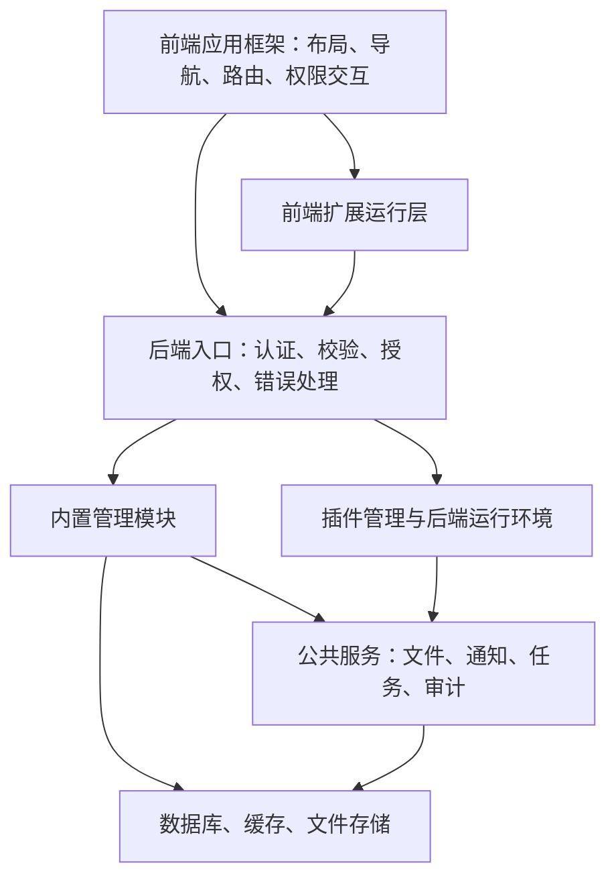

# 全栈管理系统架构构思

归档日期：2026-11-06。

状态：讨论草案。本文记录当前目标、已确认约束和建议架构，不表示相关能力已经实现。后续设计应在此基础上逐项确认，具体功能按阶段建设。

## 1. 系统定位与已确认约束

目标是建设一个功能相对完善、支持标准化扩展的通用管理系统，让使用者能够独立开发、安装功能插件，尽量避免修改系统源码，并便于后续升级宿主系统。

已确认的方向：

- 管理系统本身需要具备完整的基础管理能力，插件能力作为框架基础设施纳入设计。
- 前后端都支持插件；插件独立开发、独立构建、独立安装。
- 安装、升级和卸载插件不要求重新构建宿主，也不要求重启后端主服务。
- 前端允许在刷新页面后初始化并加载插件，不要求已打开页面即时加载或卸载插件。
- 由管理员安装经过信任的插件，首版不以运行未经信任的任意第三方代码为目标。
- 技术栈统一采用 Vue + TypeScript，后端采用 Node.js，并沿用现有 Fastify 框架。
- 当前阶段聚焦全栈框架的总体架构，不展开插件开发细节或具体插件验证方案。

## 2. 建议的总体架构

建议采用“模块化单体宿主 + 独立插件运行环境”。内置管理功能按业务模块组织，插件通过公开扩展接口接入；后端插件独立进程运行是当前建议，仍需在详细设计中确认。



图中表达逻辑职责，不代表每一部分都需要部署成独立服务，也不定义插件直接访问数据库的策略。

## 3. 宿主系统的职责划分

下表为建议的架构范围，具体功能清单与首版范围尚待确定。

| 架构部分 | 主要职责 |
| --- | --- |
| 前端应用框架 | 布局、导航、路由、主题、国际化、状态管理、统一请求与异常展示 |
| 后端应用框架 | 配置加载、接口校验、响应规范、错误处理、接口文档、请求追踪 |
| 身份与权限 | 登录与会话、用户、角色、操作权限、业务数据访问范围 |
| 基础管理模块 | 用户管理、角色管理、系统设置、字典、登录记录、操作审计 |
| 公共服务 | 文件存储、通知、后台任务、事件机制，按实际需求逐步提供 |
| 插件基础设施 | 前端扩展注册、安装管理、后端运行管理、请求转发、兼容检查 |
| 数据与存储 | 数据归属、事务、迁移、缓存策略、备份与恢复 |
| 部署与运维 | 环境配置、健康检查、日志、监控、版本升级与故障恢复 |

### 3.1 模块边界

建议按业务职责组织代码。一个内置模块拥有对应的页面、接口、业务逻辑和数据访问实现；模块之间通过明确的服务接口协作。

前端页面负责交互与组合，后端入口负责请求处理，业务规则集中在对应模块的服务中。公开的扩展协议与宿主内部实现分开维护，避免插件直接引用内部源码。

### 3.2 权限边界

建议将身份与权限作为统一基础能力。前端负责菜单和按钮的展示，后端负责每次请求的操作权限与资源访问范围校验。

内置功能与插件请求遵守相同的身份和权限规则；插件的安装、启停、升级和卸载操作也应纳入权限控制与审计。

### 3.3 公共能力边界

配置、日志、文件等公共能力应提供明确的调用接口。内置模块和插件按约定使用这些能力，公开接口需要兼容策略，避免宿主内部调整直接影响扩展。

事件用于明确的业务通知与扩展场景；需要返回结果或保证事务一致性的操作，应明确调用与事务边界。

## 4. 宿主对插件的支持方式

### 4.1 前端

建议设置统一的扩展注册中心，管理菜单、路由、全局组件区域和设置入口。内置功能与插件使用相同的扩展位置，布局按注册结果渲染。

页面启动时获取当前用户可用的已启用插件，加载必要资源并完成注册，再进入目标页面。安装、启停和升级后的前端变更允许通过刷新页面生效。

插件产物独立于宿主前端构建，通过运行时资源入口提供。加载工具、共享依赖和样式边界留待详细设计确定。

### 4.2 后端

建议由宿主预先提供固定的插件请求网关，根据插件 ID、启用状态和运行记录，将请求转发到对应插件进程。

插件运行管理负责启动、健康检查、退出、故障状态和升级替换；插件通过明确的通信接口调用宿主公开能力。独立进程用于运行管理与故障边界，不将其视为运行不可信代码的安全沙箱。

后端主服务不重启是已确认要求；插件升级期间的可用性、在途请求处理和数据迁移策略尚未确定，不能据此承诺插件升级零中断。

### 4.3 管理与状态

建议由数据库记录插件版本、配置、启用状态及安装结果，由持久化目录保存安装产物。启动时根据持久化状态恢复需要运行的插件，并检查实际运行状态。

插件停用后的后端访问限制应立即执行，不能仅依赖前端刷新隐藏入口。卸载插件与删除业务数据应分开定义，具体规则待确认。

## 5. 工程组织建议

沿用现有 apps、packages、docs 和 docker 结构。以下是候选职责划分，不表示这些目录或模块已经存在，也不要求立即迁移现有代码。

```text
apps/
├─ frontend/src/
│  ├─ platform/          # 前端布局、导航、权限交互等基础能力
│  ├─ modules/           # 内置管理功能
│  └─ plugin-runtime/    # 插件加载与扩展注册
└─ backend/src/
   ├─ platform/          # 后端请求、认证授权与公共服务基础能力
   ├─ modules/           # 内置管理功能，包含插件管理
   └─ plugin-runtime/    # 插件网关、运行管理与宿主通信
packages/
├─ config/              # 共享工程配置
├─ database/            # 数据库相关职责的候选承载位置
├─ shared/              # 稳定的共享类型与工具
└─ plugin-contract/     # 宿主与插件之间的公开协议
docs/                   # 架构与开发文档
docker/                 # 容器运行配置
```

共享包按实际复用需要建立。数据库代码是否迁入 packages/database，以及公开 SDK 的包划分，均留待后续设计。

## 6. 部署与运维建议

以现有 Docker Compose 部署为基础，分别管理宿主镜像、插件产物、数据库数据和上传文件的生命周期。

- 插件产物使用独立持久化目录，并提供静态资源访问入口；安装插件无需重建宿主镜像。
- 数据库和需要保留的文件使用持久化存储，明确备份与恢复范围。
- 配置与密钥通过部署环境管理，区分开发和生产环境。
- 宿主和插件运行状态纳入健康检查、日志与监控。
- 宿主升级、插件升级和数据库迁移分别定义流程；回退是否可行需要结合数据迁移评估。

## 7. 待确认事项

| 事项 | 当前状态 |
| --- | --- |
| 部署与租户模型 | 尚未选择“一个组织独立部署一套系统”或“一套系统服务多个租户”；此前建议优先前者，尚未确认 |
| 首版管理功能范围 | 上文为建议范围，尚未确定各功能的建设阶段 |
| 身份与权限细节 | 会话方式、数据权限和组织模型待设计 |
| 插件运行实现 | 独立进程为建议方案，通信、故障恢复与升级切换方式待确认 |
| 插件数据访问 | 插件业务数据与系统数据的管理、访问和迁移策略尚未确认 |
| 前端加载方式 | 运行时加载方向已明确，具体工具、依赖共享与兼容机制待确定 |
| 扩容方式 | 多实例下的插件文件分发、运行状态与任务归属尚未设计 |

后续讨论优先完善宿主系统的边界与职责，再逐项细化数据、权限、部署和插件运行机制。
